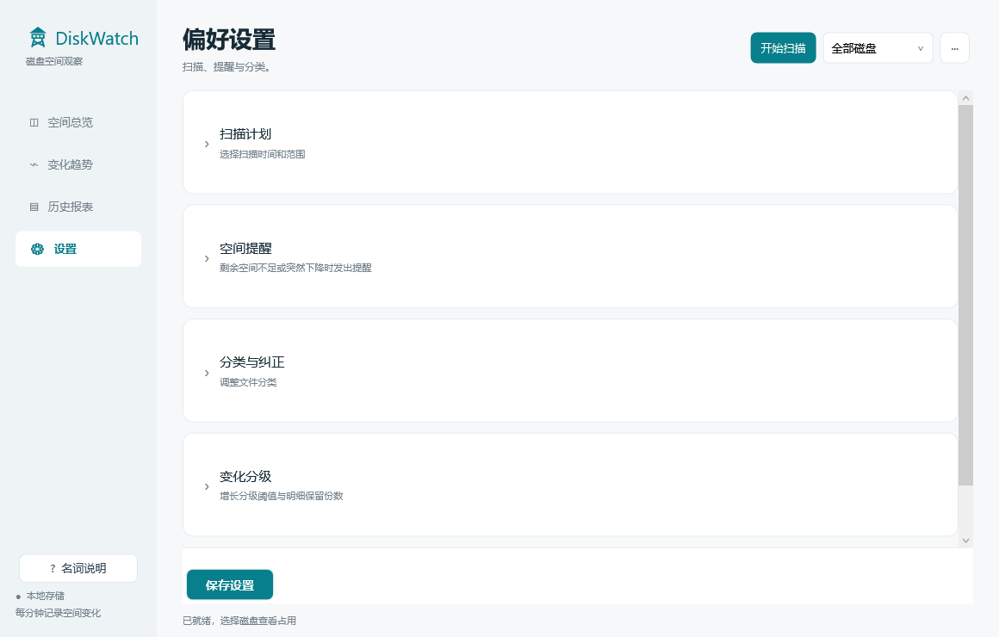
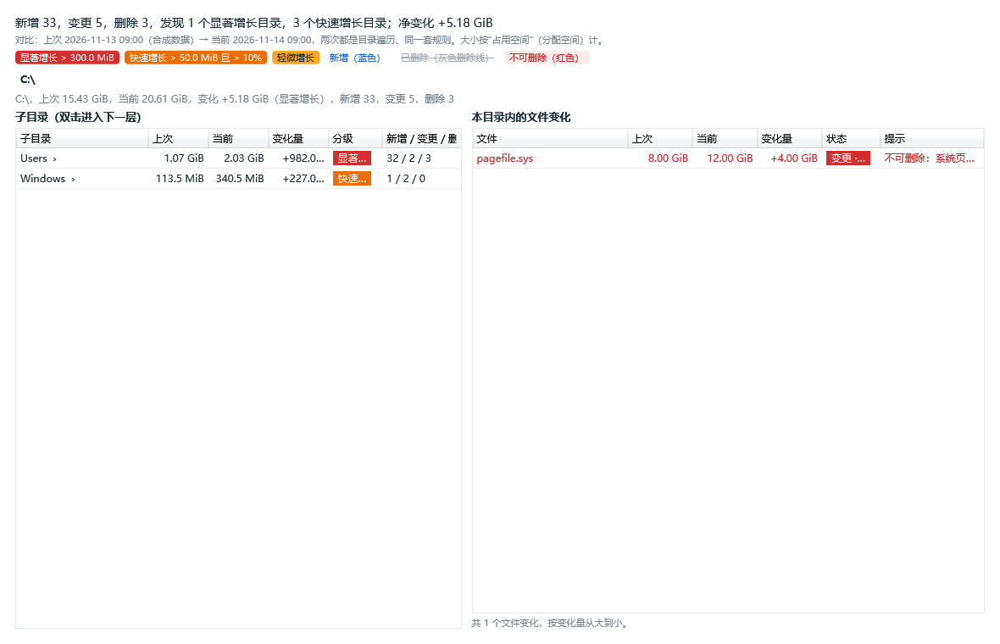
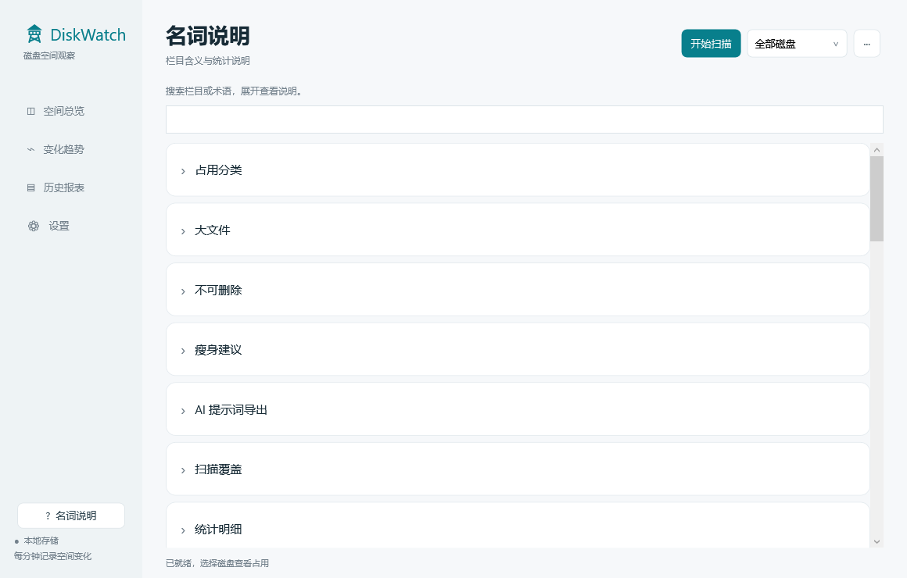

# DiskWatch

Windows 磁盘空间监视工具。跟踪各磁盘占用，生成日、周、月报表，并对增长进行分类与提醒。

扫描结果、设置和报表都保存在本机，不会上传。

## 功能

- 空间总览：各磁盘剩余容量、最近一次扫描结果、占用分类
- 应用排行：按应用或来源查看占用与增长
- 塞满预测：根据近期剩余空间变化，估算还可使用的天数
- 周报摘要：一周内的占用变化、提醒和预测
- 变化明细：目录级增长下钻，按显著 / 快速 / 轻微增长标色
- 瘦身建议：只读给出可清理或可转移的项目
- 导出 AI 提示词：把建议导出为提示词，便于在其他工具中核实后再处理
- 空间提醒：剩余空间不足或短时间明显下降时发出提醒
- 可选：空间骤降时自动扫描（默认关闭）

## 界面预览







## 下载

1. 打开 [Releases](https://github.com/neoaui/DiskWatch/releases)，下载 `DiskWatch-v0.1.0-win-x64.zip`。
2. 解压到一个空文件夹，双击 `DiskWatch.exe`。
3. 启动时会请求管理员权限：点「是」可使用 NTFS 快速扫描；点「否」仍可使用，并自动改用普通扫描。

发布包已包含运行环境，不必另装 .NET。若 Windows 提示「已保护你的电脑」，可点「更多信息」，再点「仍要运行」。

数据保存在 `%LOCALAPPDATA%\DiskWatch`。卸载时删除解压出的文件夹，以及上述数据目录。

## 运行环境

- 使用发布包：Windows 10 或 Windows 11（64 位）
- 从源码编译：另需 [.NET 10 SDK](https://dotnet.microsoft.com/download/dotnet/10.0)

## 编译和运行

在仓库根目录执行：

```powershell
# 使用已加入 PATH 的 dotnet，或先设置 DOTNET_ROOT 指向 SDK 目录
.\build.ps1 -Test -Publish
.\DiskWatch2.exe
```

也可以直接运行发布目录中的 `DiskWatch.App.dll`：

```powershell
dotnet run --project src\DiskWatch.App\DiskWatch.App.csproj -c Release
# 或发布后再运行
dotnet release\net10\DiskWatch.App.dll
```

打包可供下载的绿色版（需 .NET 10 SDK）：

```powershell
.\pack-release.ps1 -Destination C:\Temp\DiskWatch-release
```

从源码在仓库中运行时，数据默认写在仓库下的 `data\`、`logs\`、`exports\` 和 `work\`。使用发布包时，数据默认写在 `%LOCALAPPDATA%\DiskWatch`。也可通过环境变量 `DISKWATCH_ROOT` 指定目录。

首次启动会请求管理员权限。未获得权限时仍可运行，并自动改用普通扫描。

## 为什么需要管理员权限

在 NTFS 磁盘上，管理员权限可用于“NTFS 快速扫描”，以加快枚举。这是可选项：未获得权限，或该方式不可用时，程序会改用普通扫描，结果同样可用。

## 隐私

- 所有扫描结果、设置、报表和日志只保存在本机
- 程序不会把数据上传到网络，也不会向其他应用推送通知
- 扫描只读取文件元数据（路径、大小、时间等），用于汇总占用
- 瘦身建议和导出的提示词默认不会删除或移动任何文件

## 许可证

版权所有 (C) 2026 neoaui

本程序是自由软件，依照 GNU 通用公共许可证第 3 版（GPL-3.0）发布。完整文本见 [LICENSE](LICENSE)。

---

## English

DiskWatch is a Windows disk space monitor. It tracks drive usage, builds daily, weekly and monthly reports, classifies growth, and shows alerts, app rankings, fill forecasts, slimming suggestions and an exportable AI prompt.

All data stays on the local computer. Nothing is uploaded.

A ready-to-run Windows x64 package is on the Releases page; extract it and double-click DiskWatch.exe. No separate .NET install is required. To build from source, install the .NET 10 SDK and run `.\build.ps1 -Test -Publish`. Administrator rights are optional and only used for faster NTFS scanning; the app falls back to a regular scan if elevation is declined.

Copyright (C) 2026 neoaui. Licensed under the GNU General Public License v3.0. See [LICENSE](LICENSE).
